# Mermaid diagram examples

[Mermaid](https://mermaid.js.org/) turns short text into diagrams. GitHub renders any ```` ```mermaid ```` block
in a Markdown file, so these show as pictures on GitHub. Copy one, change the names, and it updates.
Tip: [mermaid.live](https://mermaid.live) previews as you type.

Examples go from simple to more involved, using the jobs in this repo.

---

## 1. A simple flow

`LR` = left to right (`TD` = top down). `-->` is an arrow.

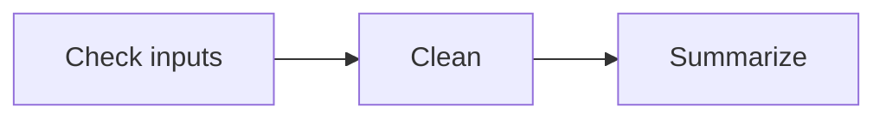

## 2. Node shapes

The brackets around a label set its shape.

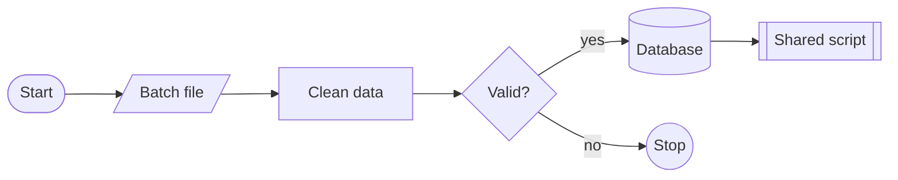

| Shape | Syntax | Typical use |
|---|---|---|
| Rectangle | `id[Text]` | a step / task |
| Rounded pill | `id([Text])` | start or end |
| Parallelogram | `id[/Text/]` | a file or input |
| Diamond | `id{Text}` | a decision |
| Cylinder | `id[(Text)]` | a database |
| Circle | `id((Text))` | a stop or event |
| Double-sided box | `id[[Text]]` | a shared routine |

## 3. Arrow styles and labels

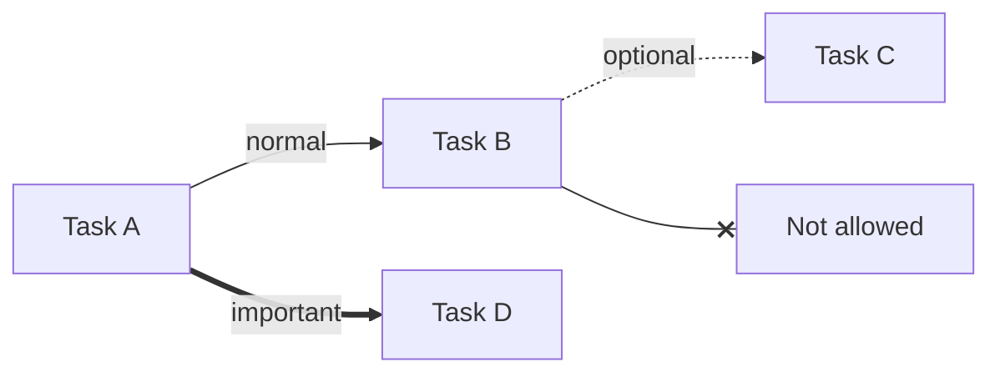

`-->` solid, `-.->` dotted, `==>` thick, `--x` ends in a cross, `-->|label|` adds text.

## 4. An Airflow job as a DAG (example 3)

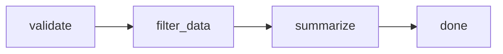

## 5. Fan-out, fan-in, and "no loops"

Parallel steps branch out and join again. A dashed red arrow back to the start shows a loop, which Airflow rejects.

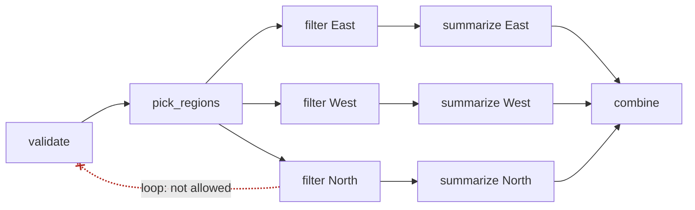

## 6. Colouring by state, with a task group

`classDef` defines a style; `class` applies it. `subgraph` draws a box around related steps.

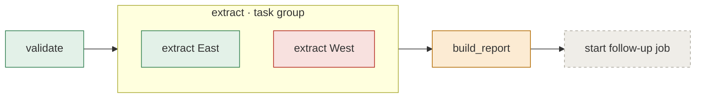

## 7. Branching on an input (example 4)

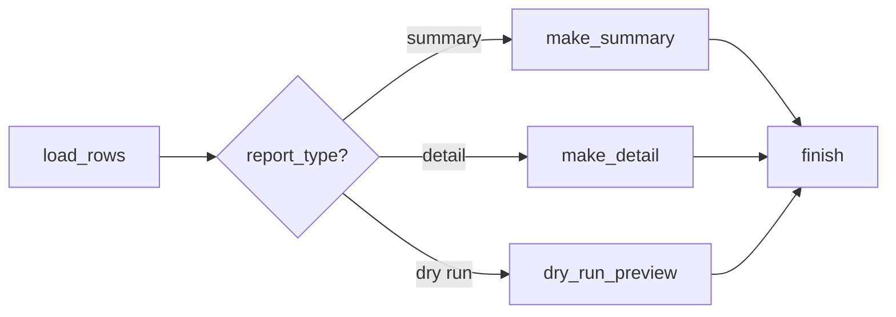

## 8. A batch job with files, scripts and a database (example 8)

Every step runs through the same shared `run_python_step.sh`; each box shows which script it runs.

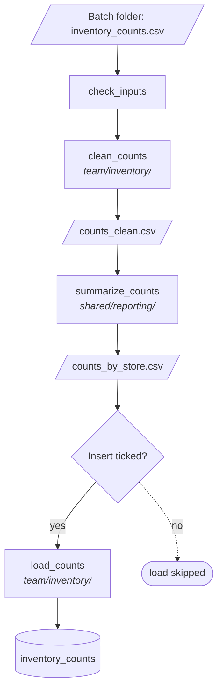

## 9. Two tasks sharing data through the database (example 9)

Task 2 never receives task 1's DataFrame; it reads task 1's rows back from the database.

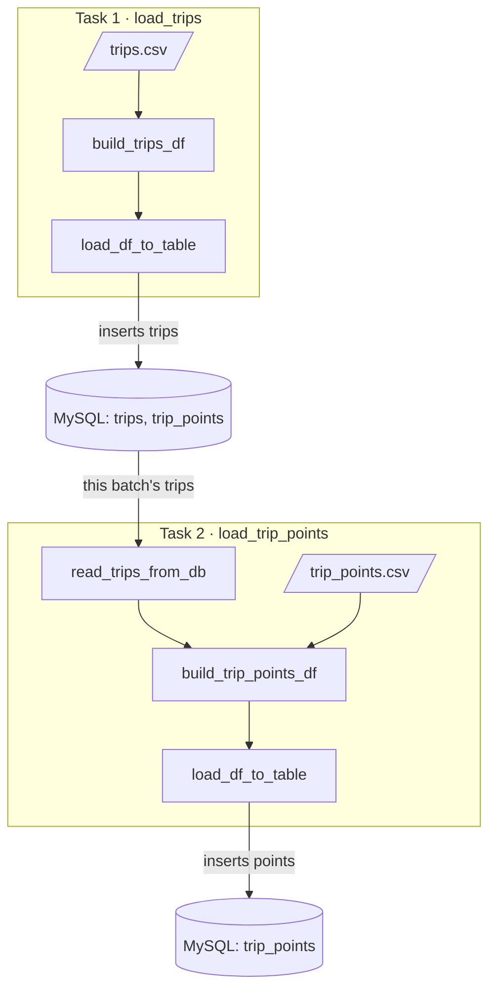

## 10. ERD: the tables behind examples 8 and 9

`||--o{` reads "one to zero-or-more". `PK` / `FK` mark keys.

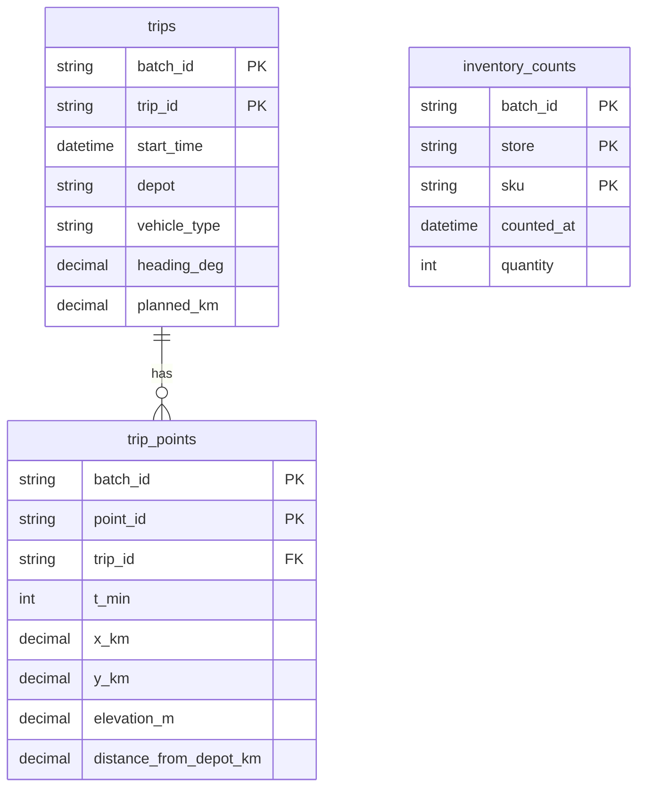

| Symbol | Meaning |
|---|---|
| `\|\|` | exactly one |
| `o\|` | zero or one |
| `}o` / `o{` | zero or more |
| `}\|` / `\|{` | one or more |

## 11. Sequence: what happens when you click Trigger

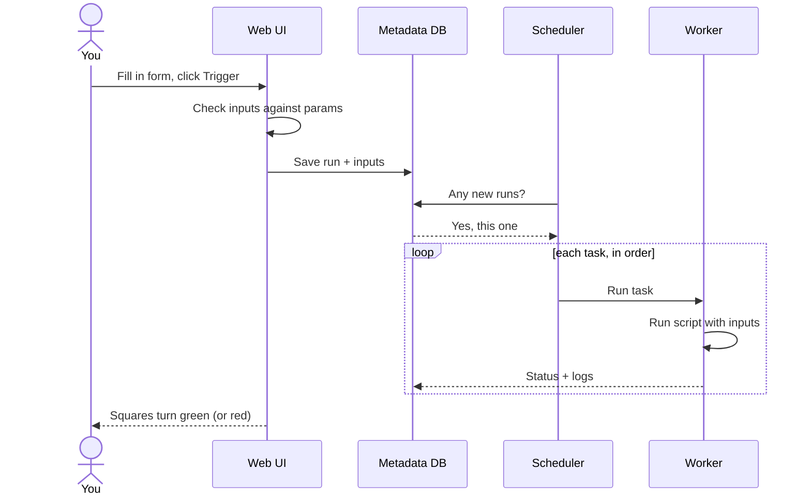

## 12. State diagram: a task's life

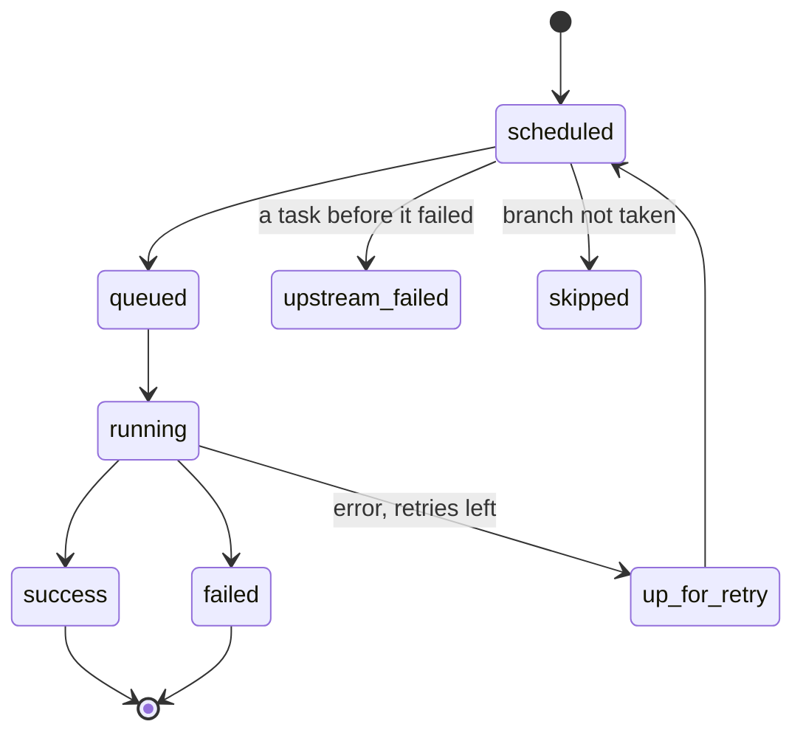

## 13. Gantt: planning the rollout

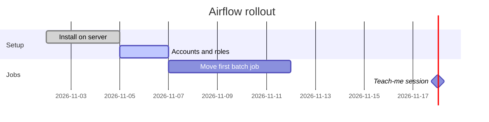

---

**Reference:** [Mermaid docs](https://mermaid.js.org/intro/) ·
[Flowchart syntax](https://mermaid.js.org/syntax/flowchart.html) ·
[ERD syntax](https://mermaid.js.org/syntax/entityRelationshipDiagram.html) ·
[GitHub: creating diagrams](https://docs.github.com/en/get-started/writing-on-github/working-with-advanced-formatting/creating-diagrams)
